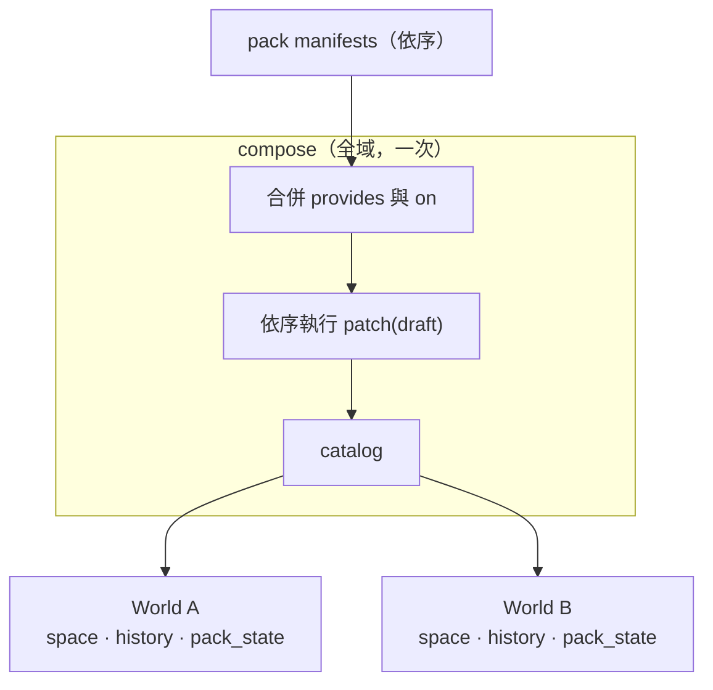

# Runtime Architecture

設計推演見 [docs/QA/2610140017.md](../docs/QA/2610140017.md)。

## Core Idea

Packs 只描述，runtime 負責組裝。
Catalog 是全域、組裝後不可變的定義；World 持有正在執行的狀態。



## Pack manifest

```ts
interface pack_manifest
{
    pack_id:       string;
    provides?:     { items?, recipes?, devices?, operations?, commands? };
    on?:           Record<string, hook_callback>;   // 'namespace:id' → handler(world, ...args)
    create_state?: () => unknown;                   // 每個世界的 pack 私有狀態
    patch?:        (draft: catalog) => void;        // 組裝期間修改尚未凍結的 catalog
}
```

## Lifecycle

### 1. Compose

`compose(manifests)` 依 `ENABLED_PACKS` 順序：

1. 合併所有 `provides` 至 `catalog.registry`，合併所有 `on` 至 `catalog.handlers`。
2. 依相同順序呼叫每個 pack 的 `patch(draft)`。

列表順序即 handler 的執行順序。

### 2. Create World

`new pure_world(catalog, space, id?)` 建立 `history`，並以 `create_state` 產生 `pack_state`。

### 3. Run World

所有改變狀態的操作都經過唯一的寫入路徑：

```text
submit / undo / redo / jump_*
  → commit：透過 history.ts 套用 op
  → 由游標移動前後推導 change_set（先 inverse 至 LCA，再 execute）
  → emit core:committed(world, change_set)
```

`delete_history_node` 不改變 space，以空的 `change_set` 發出 `core:committed`。

## Invariant

> **Handlers 是全域且不可變的；世界透過參數傳入。**

Handler 只操作它收到的 world，因此 World A 的事件不會影響 World B。
